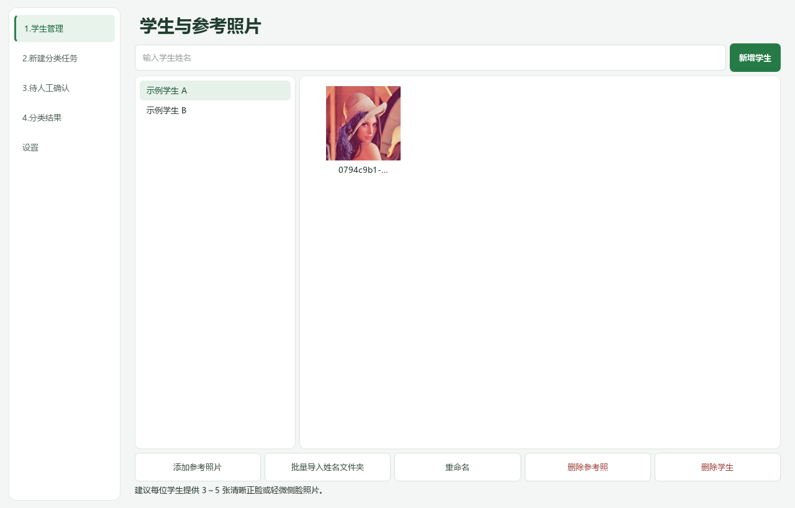
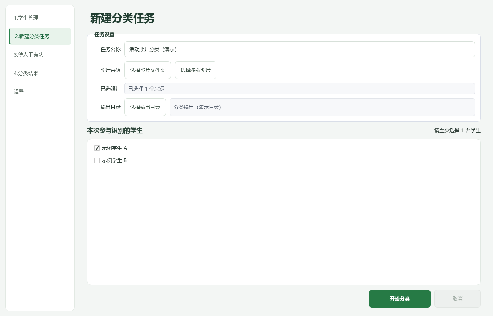
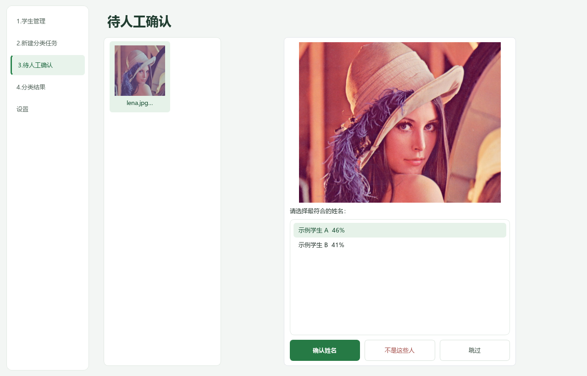
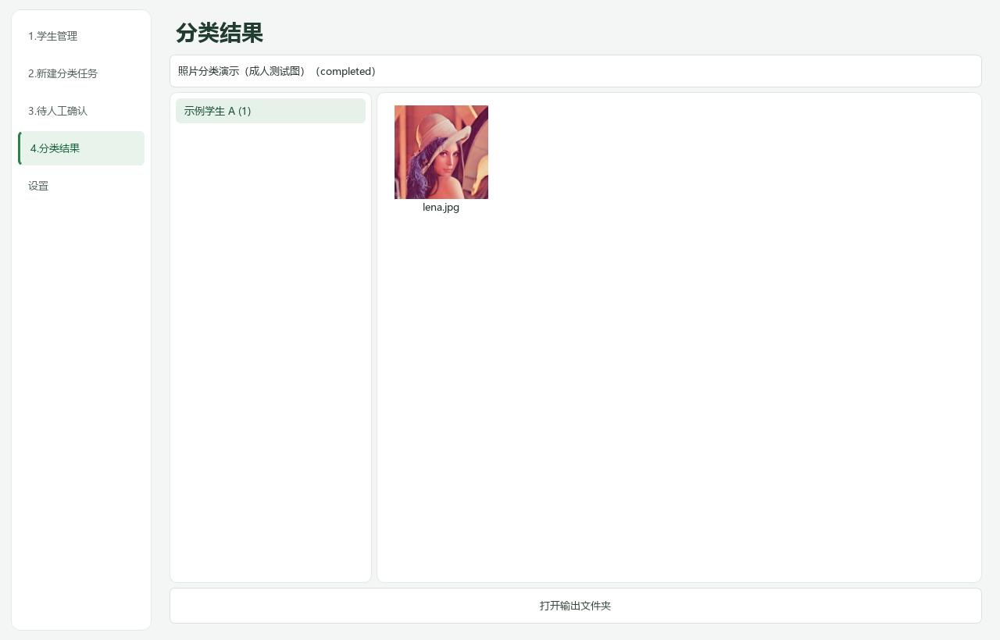
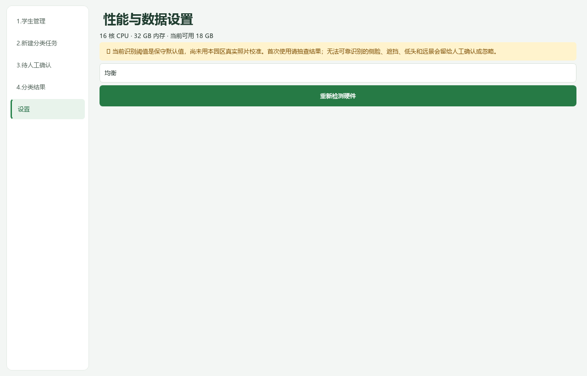

# 园区照片分类助手

适用于 Windows 10/11 的离线照片分类桌面工具。为每位学生建立参考照片库，再将活动照片按识别结果**复制到姓名文件夹**。多人合照可同时出现在多位学生的目录中，原始照片不会被移动、修改或删除。

本文按当前源码整理，项目版本为 `0.1.0`。人脸检测和特征比对均在本机完成，无需上传照片或调用在线识别服务。

## 已实现功能

| 模块 | 当前功能 |
| --- | --- |
| 学生管理 | 新增、重命名、删除学生；姓名重复和 Windows 非法文件名校验；学生变更同步到任务选择列表 |
| 参考照片 | 为选中学生添加或删除参考照；按姓名子文件夹批量导入；单人脸及最小人脸尺寸检查；缩略图和双击打开 |
| 分类任务 | 自定义名称，选择照片文件夹或多张照片、输出目录及参与学生；后台执行、进度显示、取消任务 |
| 照片处理 | JPG/JPEG、PNG、BMP、WebP；单次扫描按 SHA-256 去重；处理 EXIF 方向，缩小分析图而保留原始输出文件 |
| 本地识别 | OpenCV YuNet 检测与 SFace 特征比对；按相似度和候选差距决定自动分类、人工确认或未知 |
| 人工确认 | 待确认缩略图队列、照片预览及最多 3 个候选姓名；确认姓名、不是这些人、跳过；双击队列图片打开源照片 |
| 分类结果 | 选择历史任务，按姓名查看已成功复制的照片数量及缩略图；双击打开分类副本；打开输出根目录 |
| 界面与设置 | 缩略图异步加载、列表分批添加、缺失图片占位提示；显示 CPU、总内存和可用内存，支持重新检测硬件 |
| 输出保护 | 按任务 ID 和姓名隔离输出；多人合照分别复制；同名不同内容追加哈希后缀，避免直接覆盖 |

## 技术栈

| 层次 | 技术 | 项目中的用途 |
| --- | --- | --- |
| 开发语言 | Python 3.12 | 应用逻辑、图像处理、任务编排与本地文件管理 |
| 桌面界面 | PySide6 Essentials / Qt Widgets | 五个功能页面、信号与槽、QThread 后台任务及异步缩略图 |
| 人脸检测 | OpenCV / YuNet | 使用 `cv2.FaceDetectorYN` 检测人脸位置和关键点 |
| 人脸识别 | OpenCV / SFace | 使用 `cv2.FaceRecognizerSF` 对齐人脸、提取特征；与参考特征进行相似度比对 |
| 数值计算 | NumPy | 特征向量归一化、点积相似度计算及图像数组处理 |
| 图片读写 | Pillow、OpenCV | 图片解码、EXIF 方向纠正、分析图缩放及 RGB/BGR 转换 |
| 数据存储 | SQLite（Python 标准库 `sqlite3`） | 保存学生、参考特征、分类任务、人脸判断和照片分配记录；启用外键与 WAL |
| 硬件检测 | psutil、`os.cpu_count` | 获取内存和逻辑 CPU 信息 |
| 文件与备份 | `pathlib`、`shutil`、`hashlib`、`zipfile` 等标准库 | 路径管理、照片复制、SHA-256 校验及底层备份服务 |
| 依赖与构建 | uv、setuptools | 开发环境同步、依赖锁定和 Python 包构建 |
| 测试与检查 | pytest、pytest-qt、Ruff | 单元/集成测试、Qt 界面测试和静态代码检查 |
| Windows 打包 | PyInstaller | 将应用和本地模型打包为单文件 EXE；另保留 Inno Setup 安装器脚本 |

运行依赖及版本范围以 [pyproject.toml](pyproject.toml) 为准，uv 锁定依赖见 [uv.lock](uv.lock)。OpenCV 使用 `opencv-python-headless` 包，桌面窗口由 PySide6 提供。YuNet 和 SFace 模型均为本地 `.onnx` 文件，由 OpenCV 加载推理。

主要调用链：`app.py` 组装窗口与服务 → `NewTaskPage` 启动后台任务 → `ClassificationController` 扫描、解码并识别人脸 → `DecisionPolicy` 判定归属 → `OutputService` 复制照片并记录结果。人工确认和历史结果查询也通过应用层访问本地数据库。

## 快速开始

### 使用已打包程序

若已有发布包，解压 `ImageGroup-portable-win64.zip`，运行其中的 `园区照片分类助手.exe`；也可直接运行单文件 EXE，无需另装 Python。本地打包产物放在 `releases/`，该目录不纳入 Git。

### 从源码运行

需要 **Python 3.12**，推荐使用 uv。在项目根目录执行：

```powershell
uv sync --extra dev
uv run image-group
```

也可使用标准虚拟环境，按 `pyproject.toml` 安装项目依赖：

```powershell
py -3.12 -m venv .venv
.\.venv\Scripts\python.exe -m pip install -e ".[dev]"
.\.venv\Scripts\python.exe -m image_group.app
```

本地模型位于 `resources/models/`，启动时会校验文件及 SHA-256；缺失或被修改时无法启动识别。模型随源码提供，运行识别无需联网。

## 分类流程

1. **准备学生资料**：在“1.学生管理”输入姓名并新增学生，为每人添加建议 3～5 张清晰、单人正脸或轻微侧脸参考照。双击缩略图可打开照片。
2. **或批量导入**：点击“批量导入姓名文件夹”，选择包含姓名子文件夹的父目录，例如：

   ```text
   参考照片/
   ├── 张小明/
   │   ├── 正脸.jpg
   │   └── 轻微侧脸.jpg
   └── 李小红/
       └── 正脸.png
   ```

   按直接子文件夹名称新建学生，只读取姓名文件夹中的直接图片文件；已有同名学生会导致该文件夹导入失败，不会自动合并。

3. **创建任务**：进入“2.新建分类任务”，设置名称、照片来源、输出目录，并至少勾选一名有有效参考照的学生。文件夹扫描只读取当前层，不递归扫描子文件夹。
4. **开始分类**：点击“开始分类”查看进度。取消操作会在照片处理循环的检查点生效，已经生成的副本会保留。
5. **人工复核**：进入“3.待人工确认”，选择队列图片和候选姓名，点击“确认姓名”后生成分类副本；“不是这些人”和“跳过”会移出当前待确认队列。
6. **查看结果**：进入“4.分类结果”，选择任务，再点击姓名浏览照片。发送给家长前请复核结果。

输出目录结构如下，任务名称用于界面展示，磁盘上的任务目录使用唯一任务 ID：

```text
所选输出目录/
└── <任务ID>/
    ├── 张小明/
    │   ├── 活动合照.jpg
    │   └── 游戏.jpg
    └── 李小红/
        └── 活动合照.jpg
```

## 功能截图

以下为当前源码的实际 Qt 界面渲染截图，使用独立演示数据库和仓库自带的 `tests/fixtures/lena.jpg` 成人测试图，不包含真实学生资料。示例姓名不代表图片中的人物身份；人工确认队列及分数为预置演示数据，不能作为识别准确率依据。

### 学生与参考照片

管理姓名和参考照片，支持单人添加、按姓名目录批量导入、重命名及删除。



### 新建分类任务

集中设置任务名称、来源、输出目录，并勾选本次参与识别的学生。



### 待人工确认

左侧浏览待确认队列，右侧查看照片和候选姓名，进行确认、排除或跳过。



### 分类结果

按任务和姓名浏览已复制的照片，可双击打开副本或打开输出目录。



### 性能与数据设置

查看硬件信息并重新检测。截图中的硬件数值取自截图生成环境。



## 数据保存与当前边界

- 默认数据目录为 `%LOCALAPPDATA%\ImageGroup\`，包含 SQLite 数据库 `data.db` 和托管参考照片 `reference/`；分类副本保存在用户选择的输出目录。
- 参考照包含多人、未检测到人脸或人脸太小时会拒绝导入。参考照不足会影响识别，当前界面不会阻止选择没有有效参考照的学生。
- 默认识别阈值尚未用本园区真实照片校准。侧脸、低头、遮挡、远景和后脑勺可能无法识别；低分、过小或未检测到的人脸不保证进入人工确认队列，也不会生成姓名目录副本。
- 候选姓名旁的百分比是相似度分数的界面表达，不是识别正确概率。人工确认只支持选择候选姓名，当前没有任意指定其他学生或撤销处理的界面。
- “设置”中的节能、均衡、高速选项目前仅为界面选项，尚未接入分类任务执行参数或持久化保存。
- 备份/恢复、CSV 报告和失败复制重试已有底层服务，但尚无桌面操作入口；当前不提供界面中的任务恢复或报告导出。
- 重命名不会自动改写已有输出文件夹；删除学生会删除数据库关联记录和托管参考照，当前实现不会清理已生成的分类副本，尽管删除确认提示中写有删除副本。需要清理时请单独检查输出目录。
- 参考照、人脸特征及分类结果均保存在本地，请管理好 Windows 账户和资料访问权限。更多基础说明见 [使用说明](docs/user-guide.md)。

## 开发与打包

定向运行界面和工作流测试：

```powershell
uv run --extra dev pytest -q tests/ui tests/integration
```

运行全量测试及代码检查：

```powershell
uv run --extra dev pytest -q
uv run --extra dev ruff check src tests
```

Windows 下双击 `一键重新打包.bat`，会依次同步开发依赖、运行测试和代码检查、使用 PyInstaller 生成单文件 EXE、更新 `releases/` 中的 EXE/ZIP，并输出 SHA-256。任一阶段失败即停止。也可手动构建：

```powershell
uv run --extra dev pyinstaller --noconfirm --clean packaging/ImageGroup.spec
```

## 项目目录与职责

```text
ImageGroup/
├── src/image_group/          Python 应用源码
│   ├── app.py               程序入口、默认数据路径、模型与服务组装
│   ├── application.py       分类控制器、人工确认处理与结果查询服务
│   ├── ui/                  Qt 界面、共享主题、图片打开和异步缩略图
│   ├── domain/              学生、参考照片、人脸等领域数据模型
│   ├── people/              学生与参考照管理、批量导入、识别后端适配
│   ├── photos/              图片加载、EXIF 方向处理和分析图缩放
│   ├── recognition/         识别接口、OpenCV 模型后端与分类判定策略
│   ├── tasks/               照片扫描去重及独立任务执行器
│   ├── output/              按任务和姓名复制文件、同名冲突处理
│   ├── storage/             SQLite 建表迁移、连接管理与学生数据仓储
│   ├── hardware/            CPU/内存检测及并发参数规划
│   ├── backup/              备份创建、校验和恢复底层服务
│   └── reports/             CSV 报告写入及单元格内容保护
├── resources/models/        YuNet/SFace 模型、哈希清单和模型许可证
├── tests/                   按模块组织的单元、界面、集成及打包测试
│   └── fixtures/            自动化测试使用的图片素材
├── benchmarks/              批处理基准脚本
├── docs/                    项目文档
│   ├── user-guide.md        基础使用说明
│   ├── screenshots/         README 中引用的五个功能页面截图
│   └── superpowers/         已有设计规格与实施计划
├── packaging/               PyInstaller 配置与 Inno Setup 安装器脚本
├── pyproject.toml           项目元信息、依赖、命令入口与测试配置
├── uv.lock                  uv 依赖锁定文件
├── requirements.txt         独立维护的依赖清单，版本范围与项目配置存在差异
├── ruff.toml                Ruff 代码检查配置
├── 一键重新打包.bat          Windows 测试、检查、打包和发布产物生成脚本
└── THIRD_PARTY_NOTICES.md    第三方组件声明
```

`ui/` 中的 `main_window.py` 负责导航；`people_page.py`、`new_task_page.py`、`review_page.py`、`results_page.py` 和 `settings_page.py` 分别对应学生管理、任务创建、人工确认、分类结果及设置页面。`thumbnails.py` 负责异步缩略图加载，`theme.py` 定义共享样式。

`recognition/opencv_backend.py` 负责模型完整性校验、检测和特征提取；`recognition/policy.py` 负责自动分类阈值、候选差距及未知人脸判定。模型推理与归属策略分开，便于单独验证。

当前桌面分类流程由 `application.py` 编排，`tasks/runner.py` 是独立任务执行器；`hardware/` 中的并发规划和 `backup/`、`reports/` 中的服务尚未全部接入桌面操作，具体边界见上文。

运行或开发时还可能生成 `.venv/`（虚拟环境）、`.tmp/`（临时数据）、`build/`（构建中间文件）、`dist/`（打包产物）和 `releases/`（本地发布包）；这些目录不纳入 Git。

第三方组件说明见 [THIRD_PARTY_NOTICES.md](THIRD_PARTY_NOTICES.md)，模型来源和许可证见 [MODELS.json](resources/models/MODELS.json) 与 [LICENSES.txt](resources/models/LICENSES.txt)。
